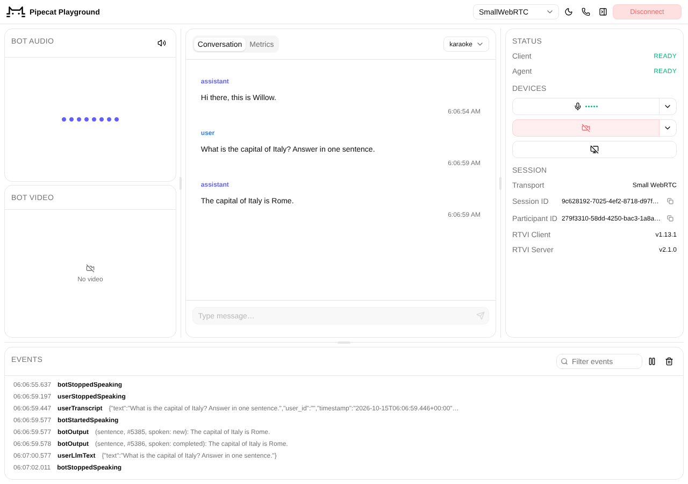

# Part 6 — A voice agent with Pipecat

**By the end of this part** you will have a voice agent running in the Pipecat
playground: open a page, press Connect, and talk to Higgs. The agent is about a hundred lines
of Python, it uses Boson's public production API, and it never shows your API key to the
browser.

Parts 0–5 built everything by hand, in the browser. Parts 6 and 7 do the opposite: they
hand the audio plumbing to an open-source agent framework, so you can see how little is
left once someone else owns the microphone, the resampling and the interruptions. This
part uses [Pipecat](https://docs.pipecat.ai/); [Part 7](part-7.md) builds the same agent
with [LiveKit Agents](https://docs.livekit.io/agents/). The two are parallel: pick the
framework your stack already uses. Neither needs Parts 1–5, but Part 0's warning about
API keys still applies.

API facts on this page were checked against `api.boson.ai` on 2026-10-15.

---

## What Higgs Realtime does

A voice agent needs to do three things: hear the caller, decide what to say, and say it.
Higgs Realtime does all three behind the one WebSocket you used in Part 1:

```
caller audio ──► Higgs Realtime ──► bot audio
                 (hears, thinks, speaks — on Boson's servers)
```

The more familiar pipeline chains three services — speech recognition, a text LLM, text to
speech — and you wire them together. Here the model hears the audio directly, which is
faster and keeps what a transcript throws away: tone, hesitation, a name spelled out letter
by letter. Your code sends audio and gets audio back.

---

## Where Pipecat fits

[Pipecat](https://docs.pipecat.ai/) is an open-source Python framework for voice agents.
A Pipecat agent is a **pipeline** of processors that frames flow through — audio frames,
text frames, control frames — and a **transport** that connects the pipeline to a caller.

Two packages do the work:

| Package | What it gives you |
| --- | --- |
| `pipecat-ai` | Pipelines, transports (WebRTC, LiveKit, phone, …), and a development runner with a browser playground |
| `pipecat-boson` | `BosonRealtimeLLMService`: Higgs Realtime as one Pipecat processor |

The shape of the whole thing:

```
browser (playground) ──WebRTC──► bot.py ──WebSocket──► wss://api.boson.ai/v1/realtime/
        mic + speakers           your server            (Authorization: Bearer <your real key>)
```

Compare that with Part 0's diagram. There, the browser talked to Boson directly and needed
an ephemeral key. Here the browser talks only to *your* server, and your server talks to
Boson. **The real key never leaves your server, so there is no ephemeral key to mint.**

---

## Run it

You need Python 3.11 or newer and [uv](https://docs.astral.sh/uv/getting-started/installation/).

```bash
cd pipecat
cp .env.example .env      # then set BOSON_API_KEY
uv run bot.py
```

The first run installs the dependencies. When you see

```
🚀 Bot ready! (WebRTC)
   → Open: http://localhost:7860
```

open that page in Chrome, press **Connect**, and allow the microphone. Willow greets you;
answer it. Interrupt a long answer and it stops.

That page is the **Pipecat playground**: a prebuilt client that ships with
`pipecat-ai[runner]`. It shows the conversation, a microphone picker and a log of every
event. You did not write any of it.



> **⚠ This will bite you: open it on `localhost`, from the same machine.**
> Browsers only allow the microphone on `https://` pages or on `localhost`. If `bot.py`
> runs on a remote dev box, an SSH tunnel for port 7860 gets you the page but usually not
> the audio: WebRTC media travels over UDP, which `ssh -L` does not carry. Run `bot.py`
> on the laptop whose browser you are using.

---

## The agent, line by line

Everything is in [`pipecat/bot.py`](../pipecat/bot.py). There are four pieces.

### 1. The service: Higgs Realtime in one object

```python
BosonRealtimeLLMService(
    url="wss://api.boson.ai/v1/realtime/",
    api_key=os.environ["BOSON_API_KEY"],
    model="higgs-realtime-1.5-preview",
    voice="default",
    instructions=INSTRUCTIONS,
    input_audio_transcription_model="higgs-stt-3.1",
)
```

On the wire this becomes the `session.update` you wrote by hand in Part 1.

`input_audio_transcription_model` is optional. The model hears your audio directly; this
only writes captions of what you said, which the playground displays. Leave it out and the
agent still understands you — you just lose the captions.

### 2. The pipeline

```python
Pipeline([
    transport.input(),   # caller audio in
    user_turns,
    llm,                 # Higgs Realtime, on Boson's servers
    transport.output(),  # bot audio out
    bot_turns,
])
```

Frames flow top to bottom. `transport.input()` produces 20 ms audio frames from the caller.
`llm` forwards them to Boson and pushes the bot's audio frames downstream to
`transport.output()`, which plays them to the caller.

`user_turns` and `bot_turns` keep the conversation history Pipecat's other processors can
read. They are built with `realtime_service_mode=True`, which means: *the server decides
when a turn ends*. Boson runs the voice-activity detection you met in Part 2, and the
aggregators follow its events. There is no local VAD in this pipeline, and you should not
add one.

> **⚠ This will bite you: do not add STT or TTS services.**
> Pipecat examples for other providers put `stt`, `llm` and `tts` in a row. Here `llm`
> already contains all of it. A Pipecat TTS service after it would speak every reply a
> second time.

### 3. Speaking first

```python
@rtvi.event_handler("on_client_ready")
async def on_client_ready(rtvi):
    await asyncio.sleep(0.5)
    await worker.queue_frames([LLMRunFrame()])
```

Higgs answers when the caller stops speaking. To have the bot speak first, ask for one
response as soon as the client is ready: `LLMRunFrame` is Pipecat's "respond now",
which the service turns into `response.create`.

Why wait for *client ready* and not just *connected*? A WebRTC connection is up before the
browser is playing audio. Speak at "connected" and the caller hears the greeting with its
first word cut off. RTVI — the small message protocol the playground speaks over the WebRTC
data channel — sends `client-ready` once the client is listening.

### 4. Tools: web search and the time

```python
async def get_current_time(params: FunctionCallParams, timezone: str | None = None) -> None:
    """Get the current date and time.

    Args:
        timezone: Optional IANA time zone, for example Europe/Paris. Omit it for the server's time.
    """
    await params.result_callback(tools.current_time(timezone))


TOOLS = ToolsSchema(
    standard_tools=[get_current_time],
    custom_tools={AdapterType.OPENAI: [{"type": "web_search"}]},
)
```

Willow has two kinds of tool, and the difference is **who runs it**.

**Web search runs on Boson's servers.** Declaring `{"type": "web_search"}` is all it
takes: there is no function to write and no result to send back. When a question needs
current information, the model says a short "let me check", the server searches the web,
and the model speaks the answer. In Pipecat it goes in `custom_tools`, which passes it to
the session as it is.

**`get_current_time` runs in this process.** This is the tool calling of Part 4, with
Pipecat doing the bookkeeping. The function's type hints and docstring become the schema
the model sees; when the model calls it, Pipecat runs it here and hands the result back.
Because it runs in your process, a tool like this can do anything your server can: query
your database, call your own APIs, look up the caller's account.

Pass the same `TOOLS` to `BosonRealtimeLLMService(tools=TOOLS)`, which advertises them in
the session, and to `LLMContext(tools=TOOLS)`, which keeps them with the conversation.

The instructions tell Willow when to use each: search for anything current, answer in a
sentence or two (search results are long, and everything is read aloud), and use
`get_current_time` for the time rather than searching for it — a page about "the time in
Tokyo" is out of date the moment it is indexed.

#### Showing sources

A search shows up as two conversation items: the call, marked `"executor": "server"`, and
then its result. `bot.py` listens for them and logs the pages the search read:

```
Searching the web (web_search)
Web search sources: https://weather.com/weather/today/l/…, https://www.accuweather.com/…
```

A client could show the same links as sources. The result text itself is written for the
model and its format may change, so take nothing from it but the links
(`tools.source_urls`).

You can also narrow the search, with `allowed_domains` or `excluded_domains` (up to five
bare hostnames such as `weather.gov`) and `location` (`{"country": "US"}`). See the
[tool use guide](https://docs.boson.ai/models/higgs-realtime/guides/tool-calling#web-search).

> **⚠ This will bite you: `web_search` is a reserved name.**
> Don't name one of your own functions `web_search`, and don't answer a call whose
> `executor` is `"server"`: the server runs it and continues by itself. `pipecat-boson`
> leaves those calls alone for you.

---

## Acceptance check

`probe.py` makes the same call the playground makes, without a browser or a microphone. It
calls `POST /start` the way the Connect button does, sets up WebRTC, says it is ready, waits
for the greeting, and then types a question, as the playground's text box does:

```bash
# terminal 1
uv run bot.py

# terminal 2
uv run probe.py --say "What's the weather in Tokyo today?"
```

It should print something like this:

```
  5.19s WebRTC connected; waiting for the greeting
  5.58s bot-ready
  6.47s bot-started-speaking
  9.07s bot said: Hi there! How can I help you today?
 10.07s typing: "What's the weather in Tokyo today?"
 10.56s bot-started-speaking
 13.52s bot said: Let me check the current weather in Tokyo for you.
 13.87s bot-started-speaking
 18.15s bot said: It's currently 72 degrees Fahrenheit and fair in Tokyo.
```

and `bot.py`'s terminal shows the search and the pages it read:

```
Searching the web (web_search)
Web search sources: https://weather.com/weather/today/l/…, https://www.accuweather.com/…
```

If the bot greets you, your key, the model and the WebRTC path all work. If it then says
"let me check" and answers with today's weather, the web search ran. Ask "What time is it
in Tokyo?" to try `get_current_time`. If nothing happens after `bot-ready`, look in
`bot.py`'s terminal for an authentication or model error. Leave out `--say` to check only
the greeting.

Then open the playground and have a real conversation, preferably with headphones on. Ask
it about today's news, interrupt a long answer, type a question into the
text box, and check that the Conversation pane shows both sides.

---

## Things to change

| To change | Set |
| --- | --- |
| The voice | `BOSON_VOICE` in `.env`: a preset name or a voice ID |
| The personality | `INSTRUCTIONS` in `bot.py`. Part 5's advice on structuring prompts applies unchanged |
| Captions | `BOSON_CAPTION_MODEL=` (empty) turns them off |
| The endpoint | `BOSON_REALTIME_URL`, for example an on-premises deployment's `ws://…/v1/realtime` |
| What web search may read | `allowed_domains`, `excluded_domains` or `location` on `{"type": "web_search"}` in `bot.py` |
| More tools | Add a function to `standard_tools` in `bot.py` |

[Part 7](part-7.md) builds the same agent with LiveKit Agents. If your product already
runs on LiveKit, that is the one to follow.

← [Part 5 — Prompting](part-5.md) · [Part 7 — A voice agent with LiveKit Agents](part-7.md) →
