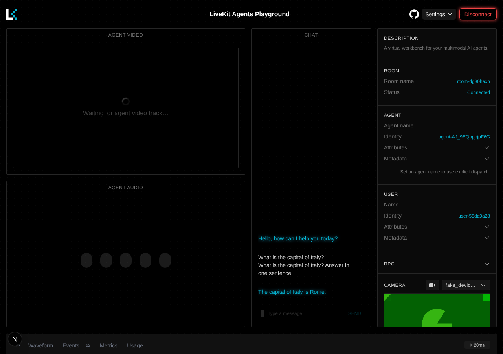

# Part 7 — A two-stage voice agent with LiveKit Agents

**By the end of this part** you will have the agent from Part 6 — the same two-stage
Higgs pipeline, the same Willow — built with [LiveKit Agents](https://docs.livekit.io/agents/)
instead of Pipecat, and you will be talking to it in the LiveKit Agents Playground.

This part does not depend on Part 6. Read [What "two-stage" means](part-6.md#what-two-stage-means)
there if you skipped it; everything else is here.

Checked against `api.boson.ai`, `livekit-server` 1.13.10 and LiveKit Agents 1.8.2 on
2026-10-15.

---

## How LiveKit is different

Pipecat's playground connects your browser straight to `bot.py`. LiveKit puts a media
server in the middle, and both sides *join a room* on it:

```
browser (Agents Playground) ──► LiveKit server ◄── agent.py (worker) ──WebSocket──► wss://api.boson.ai/v1/realtime/
                                 (a "room")
```

Three processes, then:

| Process | Role |
| --- | --- |
| `livekit-server` | Routes audio between everyone in a room. Handles NAT, TURN and reconnection. |
| `agent.py` | A **worker**. It registers with the server and is sent into each new room as the agent. |
| A client | Anything that can join a room: the Agents Playground here; LiveKit's web, iOS, Android, Flutter or Unity SDKs in your product; a phone call through LiveKit SIP. |

The extra hop buys you LiveKit's clients and its networking, and costs you a server to
run. If you already run LiveKit, this is the track for you. If you do not, Part 6 has
fewer moving parts.

The Boson integration is a LiveKit Agents plugin, `livekit-plugins-boson`. It is in review
upstream as [livekit/agents#6340](https://github.com/livekit/agents/pull/6340), so
`livekit/pyproject.toml` installs it, and the matching `livekit-agents`, from that PR's
commit. When it is released, those three lines become ordinary version pins.

---

## The agent

Everything is in [`livekit/agent.py`](../livekit/agent.py):

```python
class Willow(Agent):
    def __init__(self) -> None:
        super().__init__(instructions=INSTRUCTIONS)

    async def on_enter(self) -> None:
        self.session.generate_reply(instructions="Greet the caller in one short sentence.")


@server.rtc_session()
async def entrypoint(ctx: JobContext) -> None:
    session = AgentSession(
        llm=boson.realtime.RealtimeModel(
            api_key=os.environ["BOSON_API_KEY"],
            model="higgs-realtime",
            voice="default",
            input_audio_transcription_model="higgs-stt-3.1",
        ),
    )
    await session.start(agent=Willow(), room=ctx.room)
```

Compare it with Part 6's `bot.py`. The parts map one to one:

| | Pipecat (Part 6) | LiveKit Agents (Part 7) |
| --- | --- | --- |
| Both stages | `BosonRealtimeLLMService` | `boson.realtime.RealtimeModel` |
| Wiring | a `Pipeline` you assemble | `AgentSession` assembles it |
| Speaking first | `LLMRunFrame` on `client-ready` | `generate_reply()` in `on_enter` |
| Turn detection | the server's, via `realtime_service_mode=True` | the server's, by default |
| Who it talks to | one browser, peer to peer | a LiveKit room |

There is no STT or TTS plugin in the session, and you should not add one. `RealtimeModel`
is both stages, the same way `BosonRealtimeLLMService` is in Part 6.

> **Stage 2 is the server default here.** The LiveKit plugin does not have an option for
> the TTS model yet. When the session does not name one, the server uses its default,
> `higgs-realtime-tts`: on 2026-10-15 a session with and without the explicit name gave
> the same reply. Part 6's Pipecat service can name it (`output_audio_model`).

`input_audio_transcription_model` only produces captions of what the caller said, which
the playground shows in its chat. Stage 1 hears the audio itself and does not need it.

---

## Run it

You need Python 3.11 or newer, [uv](https://docs.astral.sh/uv/getting-started/installation/),
and Node.js with `pnpm` for the playground. Use three terminals.

### 1. The LiveKit server

```bash
brew install livekit                          # macOS
curl -sSL https://get.livekit.io | bash       # Linux

livekit-server --dev --bind 127.0.0.1 --node-ip 127.0.0.1
```

`--dev` gives it the fixed key `devkey` and secret `secret`.

> **⚠ This will bite you: `--node-ip` on a machine with more than one network.**
> In dev mode LiveKit advertises the machine's *primary* IP address for media, even with
> `--bind 127.0.0.1`. If that address is not reachable, joining a room hangs; we saw the
> LiveKit SDK give up after 20 seconds and take the joining process down with it.
> `--node-ip 127.0.0.1` keeps everything on loopback.

### 2. The agent

```bash
cd livekit
cp .env.example .env      # then set BOSON_API_KEY; the LiveKit values are --dev's
uv run agent.py dev
```

When it prints `registered worker`, it is waiting for rooms.

### 3. The Agents Playground

The [Agents Playground](https://github.com/livekit/agents-playground) is LiveKit's
open-source test client, the counterpart of Pipecat's playground. Run it against your
local server:

```bash
git clone https://github.com/livekit/agents-playground.git
cd agents-playground
cp .env.example .env.local
# in .env.local:
#   LIVEKIT_API_KEY=devkey
#   LIVEKIT_API_SECRET=secret
#   NEXT_PUBLIC_LIVEKIT_URL=ws://127.0.0.1:7880
pnpm install
pnpm dev
```

Open `http://localhost:3000`, press **Connect** and allow the microphone. The playground
creates a room, the server sends your worker into it, and Willow greets you.



> **⚠ This will bite you: the hosted playground needs LiveKit Cloud.**
> `agents-playground.livekit.io` now signs you in to LiveKit Cloud, so it cannot reach a
> server on your laptop. Run the playground locally as above, or use a LiveKit Cloud
> project for both the agent and the playground.

---

## Acceptance check

`probe.py` joins a room the way the playground does, without a browser. It signs a token
with your LiveKit key, waits for the greeting, and speaks a sentence synthesised with
Boson's TTS:

```bash
uv run probe.py --say "What is the capital of France? One sentence."
```

Expected output (run on 2026-10-15):

```
  1.76s joined room probe-fd76c3e9; waiting for the agent
  2.83s agent speaking
  6.81s agent said: Hi, this is Willow. How can I help you today?
  6.85s agent listening
  7.85s speaking 3.3s of audio: 'What is the capital of France? One sentence.'
 11.85s you said: What is the capital of France? One sentence.
 11.98s agent speaking
 14.19s agent said: The capital of France is Paris.
 14.30s agent listening
```

The `agent speaking` / `agent listening` lines come from the `lk.agent.state` attribute
that every LiveKit agent publishes. The transcripts come from LiveKit's
`lk.transcription` text streams. Your own client can use both.

> **⚠ This will bite you: publish the microphone as a microphone.**
> An agent only listens to audio tracks whose source is `SOURCE_MICROPHONE`. A custom
> client that publishes a track without setting the source joins the room fine, and the
> agent never hears it. `probe.py` sets it in `publish_track`.

---

## Where to go from here

- **Tools.** Decorate a method of `Willow` with `@function_tool`, as in the plugin's
  [example agent](https://github.com/helin-mktech/agents/blob/1e32b31795066f45c81b634e642c97ef22ba5937/livekit-plugins/livekit-plugins-boson/examples/agent.py).
  The model calls it and speaks the result.
- **Deploy.** The worker is an ordinary process: run it next to your LiveKit server, or
  against LiveKit Cloud. Your backend signs room tokens for your users, as
  `probe.py`'s `user_token()` does.
- **Phones.** Configure LiveKit SIP to send inbound calls to a room, and your worker
  answers them.

← [Part 6 — A two-stage voice agent with Pipecat](part-6.md)
